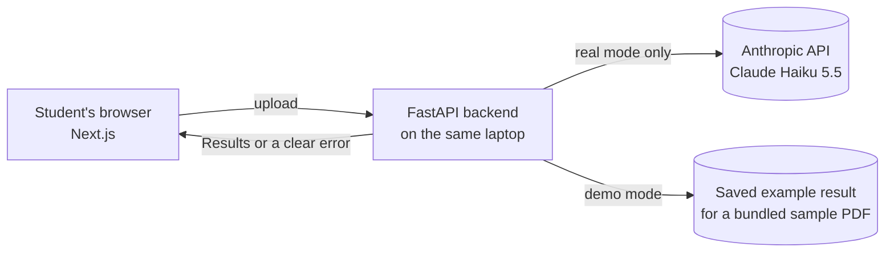
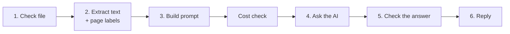

# AI Study Buddy — architecture explained

This is a short, readable tour of how AI Study Buddy is designed and why. The binding technical rules live in `ARCHITECTURE-SPINE.md` (decisions AD-1 to AD-22). The full reasoning behind each decision, including the alternatives considered and the sources checked, is in `.memlog.md` in the same folder.

## What the app does

A student uploads one lecture PDF or text file, in Norwegian (Bokmål) or English. The app sends the extracted text to an AI model once and returns a **Summary, at least 5 Flashcards, a Quiz of at least 5 questions and at least 5 Key Concepts**, with page references back to the PDF (Flashcards, Quiz items and Key Concepts always; the Summary where useful; none for plain-text files, which have no pages). It runs only on the student's own laptop. It has no accounts and stores nothing.

## The big picture



- **Frontend (Next.js):** shows the form and the Results. It holds no secrets and does no AI work.
- **Backend (FastAPI, Python):** does all processing, all checks, and the only AI call.
- **No deployment:** both parts run locally, as the course allows.

## The core idea: a six-stage pipeline

Every request goes through the same six steps in the same order. Each step can stop the request with a specific, friendly error.



| Stage | What it guarantees |
| --- | --- |
| 1. Check file | Real PDF or UTF-8 text (checked by content, not just the file name), within size limits |
| 2. Extract text | Each PDF page's text is labelled with its page number. Pages with no readable text are reported to the student, not hidden. |
| 3. Build prompt | The student's optional inputs are cleaned and fenced off, so they can't override the instructions |
| Cost check | Before any paid call: the exact request size is counted (free), with a hard cap on answer length and on calls per run |
| 4. Ask the AI | One call, through a swappable "connector": real AI, demo, or test fakes |
| 5. Check the answer | Three gates (below). Anything that fails is reported as an error, never shown half-finished. |
| 6. Reply | Either the Results with a label for the mode, or one error from a fixed list |

**Why a pipeline?** The app does one job in a fixed order, so each step can be built and tested on its own, and explained in one sentence. A classic layered web structure would have been mostly empty here, because there's no database. A more abstract "hexagonal" design would have been harder to explain for a first project.

## How the AI's answer is checked

AI output can be incomplete, wrongly shaped, padded or wrongly cited. The structured-output feature of the AI service only enforces the **shape** of the answer, so the backend adds three gates of its own:

1. **Complete?** The AI finished normally: it didn't stop early or refuse.
2. **Right shape?** Every field is present, checked by Pydantic data models.
3. **Follows our rules?**
   - At least 5 of each item type, unless the AI honestly reports `insufficient_content`. The app never invents material to reach the count.
   - Every page number must be one we actually gave the AI. Invalid numbers are removed, and if a flashcard, quiz item or concept is left with no valid page, the whole answer is rejected rather than showing uncited content.

**What this can't prove:** that a cited page truly *supports* the item. That's checked by hand during testing, using a citation-quality table (supports / partly / doesn't).

**Verification Notice:** whenever Results are shown, real or demo, a visible notice reminds the student that the content is AI-generated and should be checked against the document. It is never hidden in a tooltip or footer.

## Page references, step by step

```text
<page number="1"> Inventory basics … </page>
<page number="3"> Economic order quantity … </page>      (page 2 was an image → skipped, student is told)
→ the AI may cite only {1, 3}; anything else is removed.
```

Page numbers are the **PDF viewer's page positions**, shown as "PDF page 3", so they always match what the student sees on screen. Plain-text files carry no page numbers at all, rather than made-up ones.

## Languages

- **Source documents:** Norwegian (Bokmål) or English. Norwegian characters (æ, ø, å) are covered by automated extraction tests.
- **Output language:** the student chooses Norwegian Bokmål (the default, because the developer's own lecture notes are mostly Norwegian) or English. All four Result types are written in that language, whatever language the document is in.
- **Terminology:** subject-specific terms are kept. When the output language differs from the document's, the original term appears in brackets the first time it is used, for example "safety stock (sikkerhetslager)", so students keep the exact words used in their course. Terms are never force-translated inaccurately.
- **Page references** work the same way in both languages.
- **Interface language** (buttons, notices, messages) is decided in the UX design step.
- **Quality check:** Anthropic describes its models as multilingual, but Norwegian quality is checked by hand. At least one Norwegian document is run in both output languages, with terminology and page references reviewed.

## Demo mode

The app can run with no API key, no internet and no cost (`AI_MODE=demo`, the default):

- It works **only on a bundled sample**: an original 5–8-page lecture **in Norwegian** on inventory management and supply-chain logistics, written by the developer, with one image-only page.
- It shows **prepared results** (Norwegian, Standard detail). Changing the language or detail level in demo mode does **not** generate a new translation. Those choices are shown as fixed, with a note saying so.
- Uploading is blocked in demo mode, so it can **never pretend to analyse someone's own file**.
- The real checks still run. Only the AI call is replaced by a saved answer that was recorded once and reviewed by hand.
- It is labelled clearly: a permanent banner, an "Example results (not generated live)" heading, and a `mode: "demo"` field in every reply.

This is also how a reviewer can run the app from the README without a key.

## Security and privacy

| Risk | Design response |
| --- | --- |
| API key leaks | The key lives only in `backend/.env`, which Git ignores. The browser never sees it. The project has its own Console workspace and spend limit. A leaked key is revoked immediately. |
| Public repository | No keys, private files or copyrighted documents are committed. Samples are the developer's own work. |
| Test documents | Committing a file (publishing it) and sending it to the AI (processing it) are treated as separate permissions. Tests mainly use the developer's own lecture-style PDFs and openly licensed documents. Real course PDFs are sent for private testing only when their licence or the lecturer's or university's rules allow it, and are never committed. If permission is unclear, own samples are used. Nothing personal, confidential or sensitive is ever used. |
| Malicious document content | Document text is treated as data. Fake page labels are neutralised. All AI text is shown as plain text, never as HTML. |
| Others on the network | The backend listens only on the laptop itself (`127.0.0.1`). |
| Privacy | The app stores nothing. In real mode the student is told that text goes to Anthropic's API. Anthropic by default deletes API data within 30 days and doesn't train on it, with documented exceptions such as flagged content being kept longer. |

## Cost control (total budget USD 5–10)

- **Model:** Claude Haiku 5.5, about USD 0.003–0.005 per run. A free alternative (Gemini's free tier) was rejected because its terms allow inputs to be used for training and human review.
- **Billing:** prepaid credits with automatic top-up off. The purchased amount is the hard limit.
- **Every paid call is checked first:** exact size counted (free), answer length capped, no automatic retries, at most 20 paid calls per run.
- **Free testing:** day-to-day development and all automated tests use demo mode or test fakes.

## Testing

| Layer | Purpose | Uses real AI? |
| --- | --- | --- |
| Backend unit tests (pytest) | Every stage and every error case | No (fakes) |
| Contract tests | Frontend and backend agree on data shapes | No |
| Small frontend tests | Demo banner, notices, error messages, safe text display | No |
| Manual real-AI sessions | Citation quality and cost log on 3–5 test PDFs. Each document's source and permission are recorded. | Yes, deliberately and rarely |
| Manual UI checklist | Click through both modes, including with the network off | No |

## Development process

- **BMAD planning:** product brief → PRD → this architecture, all kept in Git.
- **Per story:** short branch → Pull Request → tests and review → merge. Nothing is committed, pushed or merged without the developer's approval.
- **Automatic tests** run on every Pull Request through GitHub Actions, without any API key.
- **AI-session evidence** (useful prompts and session notes) is kept in `docs/ai-sessions/`.

## Known limitations (by design)

- No OCR: scanned or image-only pages are skipped, and the student is told which ones.
- Tables and figures may be unreadable after text extraction.
- One document at a time, with size limits (provisionally 10 MB, 80 pages).
- Page checks prove a page exists, not that it is the best source. Quality is checked by hand.
- The interactive quiz with scoring is planned as Phase 2.
