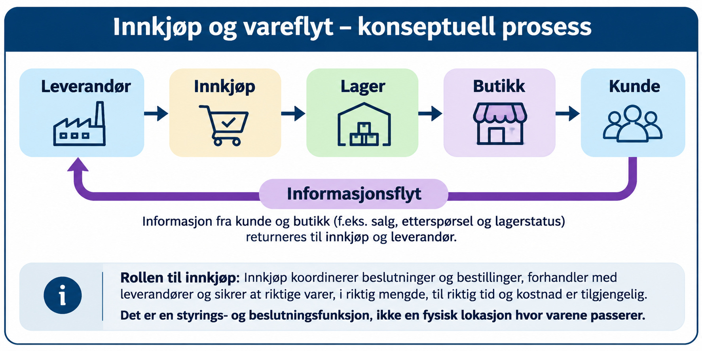

# Innkjøp, lagerstyring og vareflyt i verdikjeden

*Originalt undervisningsmateriale*

## Side 1 – Innkjøpets strategiske rolle i verdikjeden

### Fra leverandør til kunde

Innkjøpsfunksjonen har en sentral rolle i virksomhetens verdikjede. Innkjøp handler ikke bare om å bestille produkter, men også om å koordinere aktiviteter som påvirker lager, logistikk, økonomi og kundetilfredshet.

En viktig oppgave er å sikre at virksomheten får riktige varer, til riktig tid, med riktig kvalitet og til en forsvarlig kostnad.

### Innkjøp som strategisk funksjon

Innkjøpsavdelingen bidrar til verdiskaping på flere områder:

- **Vareflyt og logistikk:** Innkjøpsbeslutninger påvirker varemottak, lagerbeholdning og varepåfylling.
- **Kvalitet og omdømme:** Valg av pålitelige leverandører bidrar til god produktkvalitet og styrker kundenes tillit.
- **Lønnsomhet og likviditet:** Innkjøpspriser og bestillingsmengder påvirker fortjenestemarginer og kapitalbinding.
- **Tilbud og etterspørsel:** Innkjøp fungerer som et bindeledd mellom kundenes behov og leverandørenes kapasitet.
- **Risikostyring:** God leverandøroppfølging og planlegging kan redusere risikoen for forsinkelser og varemangel.

### Sammenhengen i verdikjeden

I en detaljhandelsbutikk er innkjøp nært knyttet til lagerstyring. Dersom innkjøpsavdelingen bestiller for store mengder, kan lagerkostnadene øke. Bestilles det for lite, kan butikken gå tom for varer.

God innkjøpsstyring innebærer derfor å balansere varetilgjengelighet, kostnader og risiko.

**Hovedpoeng:** Innkjøp er en strategisk funksjon som påvirker hele virksomhetens drift og konkurranseevne.

## Side 2 – Leverandørvalg og leveringspålitelighet

### Hva kjennetegner en god leverandør?

Når en butikk skal velge leverandør, er innkjøpsprisen viktig, men den bør ikke være det eneste kriteriet.

Andre forhold som må vurderes, er produktkvalitet, leveringspålitelighet, leveringstid, kapasitet og evnen til å håndtere avvik.

En leverandør med lav pris kan bli kostbar dersom leveransene ofte er forsinket.

### Eksempel: To leverandører

En butikk vurderer to leverandører av samme produkt:

- **Leverandør A:** Lavere innkjøpspris, men hyppige leveringsforsinkelser.
- **Leverandør B:** Noe høyere innkjøpspris, men stabile og forutsigbare leveranser.

Butikken velger leverandør B fordi pålitelig levering kan redusere risikoen for utsolgte varer og tapt salg.

Forutsigbare leveranser kan også redusere behovet for sikkerhetslager og gjøre det enklere å planlegge bestillinger, varemottak og varepåfylling.

### Total kostnad fremfor laveste pris

Ved leverandørvalg bør virksomheten vurdere de samlede kostnadene ved innkjøpet.

Disse kan omfatte innkjøpspris, transport, lagerhold, håndtering av avvik og konsekvensene av manglende varetilgjengelighet.

Selv om leverandør B har en høyere pris per enhet, kan de totale kostnadene bli lavere.

**Hovedpoeng:** Leveringspålitelighet kan være viktigere enn laveste innkjøpspris når virksomheten skal sikre effektiv drift og god kundeservice.

## Side 3 – Lagerstyring og bestillingsplanlegging

### Hvorfor er lagerstyring viktig?

Lagerstyring handler om å sikre at virksomheten har tilstrekkelige varer tilgjengelig uten å binde unødvendig mye kapital.

For høy lagerbeholdning kan skape flere utfordringer:

1. **Bundet kapital:** Pengene blir liggende i varer som ikke selges, noe som kan svekke likviditeten.
2. **Lagerholdskostnader:** Store varebeholdninger krever lagerplass og ressurser til håndtering.
3. **Reduserte marginer:** Butikken kan måtte sette ned prisene for å selge overskuddsvarer.
4. **Ukurante varer:** Produkter kan bli utdaterte, skadet eller uselgelige og føre til økonomiske tap.
5. **Redusert fleksibilitet:** Overfylte lagre kan gjøre det vanskeligere å tilpasse sortimentet til nye kundebehov.

Samtidig kan for lav lagerbeholdning føre til utsolgte varer, tapt salg og misfornøyde kunder.

### Hvordan planlegge bestillingsmengder?

En butikk bør bruke flere informasjonskilder når den planlegger innkjøp:

- **Historiske salgsdata** viser tidligere etterspørsel og salgsmønstre.
- **Sesongvariasjoner og markedstrender** hjelper butikken med å forutse endringer i etterspørselen.
- **Leverandørens ledetid** viser hvor lenge butikken må vente fra bestilling til levering.
- **Sikkerhetslager** gir en buffer mot uventet høy etterspørsel eller forsinkelser.
- **Bestillingspunkt** viser når det er nødvendig å legge inn en ny bestilling.

Et enkelt bestillingspunkt beregnes slik:

**Bestillingspunkt = gjennomsnittlig daglig etterspørsel × ledetid + sikkerhetslager**

Modellen forutsetter at gjennomsnittlig etterspørsel og ledetid gir et hensiktsmessig grunnlag for planleggingen.

**Hovedpoeng:** God lagerstyring balanserer varetilgjengelighet, kapitalbinding og lagerkostnader.

## Side 5 – Sesonginnkjøp og de seks riktige

### Julehandelen som eksempel

Julehandelen krever grundig innkjøpsplanlegging. Etterspørselen etter mange sesongprodukter øker kraftig før jul, men kan falle betydelig etter 24. desember.

Butikken må derfor sikre god varetilgjengelighet i høysesongen uten å sitte igjen med store mengder usolgte varer etterpå.

### Fem områder for god sesongplanlegging

**1. Bestillingstidspunkt og ledetid**

Varer må bestilles tidlig nok til å være tilgjengelige før etterspørselen øker. Leverandørenes ledetider kan bli lengre i høysesongen.

**2. Etterspørselsprognoser**

Tidligere salg, markedstrender og forventet kundeetterspørsel brukes til å anslå passende bestillingsmengder.

**3. Produktutvalg og sortiment**

Butikken må velge produkter som samsvarer med kundenes behov og forventede kjøpsmønstre.

**4. Lager- og butikkapasitet**

Store leveranser må tilpasses tilgjengelig lagerplass, hyllekapasitet og ressursene som trengs til varepåfylling.

**5. Avviklingsstrategi og beredskap**

Butikken bør planlegge hvordan usolgte sesongvarer skal håndteres, og hva som skal gjøres dersom leveranser blir forsinket eller etterspørselen blir høyere enn forventet.

### De seks riktige i innkjøp

Sesongplanleggingen kan knyttes til seks sentrale innkjøpshensyn:

- **Riktig kvalitet:** Varene må oppfylle forventede krav.
- **Riktig mengde:** Bestillingen må tilpasses forventet salg.
- **Riktig pris:** Prisen må gi grunnlag for lønnsom drift.
- **Riktig sted:** Varene må leveres dit virksomheten trenger dem.
- **Riktig tid:** Varene må være tilgjengelige før salgsperioden.
- **Riktig leverandør:** Leverandøren må kunne oppfylle krav til kvalitet og levering.

**Hovedpoeng:** Effektive sesonginnkjøp krever en balanse mellom salgsmuligheter, varetilgjengelighet og risikoen for overskuddslager.

## Side 6 – Praktisk eksempel: Bestillingspunkt i en butikk

### Situasjonsbeskrivelse

En fiktiv detaljhandelsbutikk selger et produkt med relativt stabil etterspørsel.

Butikken har følgende opplysninger:

| Faktor                      | Verdi      |
| --------------------------- | ---------- |
| Gjennomsnittlig daglig salg | 30 enheter |
| Leverandørens ledetid       | 5 dager    |
| Sikkerhetslager             | 50 enheter |

Butikken ønsker å vite når den bør legge inn en ny bestilling for å redusere risikoen for utsolgte varer.

### Beregning

Bestillingspunktet beregnes ved å multiplisere gjennomsnittlig daglig etterspørsel med ledetiden og deretter legge til sikkerhetslageret.

**Bestillingspunkt = (30 × 5) + 50 = 200 enheter**

Butikken bør dermed legge inn en ny bestilling når lagerposisjonen når 200 enheter.

Lagerposisjonen omfatter varer på lager pluss varer som allerede er bestilt, minus eventuelle restordrer.

### Hva betyr resultatet?

Av de 200 enhetene skal 150 dekke forventet etterspørsel i leverandørens fem dagers ledetid.

De resterende 50 enhetene fungerer som sikkerhetslager dersom etterspørselen blir høyere enn forventet eller leveransen blir forsinket.

Beregningen angir **når** butikken bør bestille, men ikke **hvor mange** enheter den skal bestille. Bestillingsmengden må vurderes separat.

### Oppsummering

Dette eksemplet viser sammenhengen mellom innkjøp, lagerstyring og leveringspålitelighet.

Ved å bruke salgsdata, ledetid, sikkerhetslager og bestillingspunkt kan butikken planlegge varepåfyllingen mer systematisk.

God planlegging kan bidra til færre utsolgte varer, lavere lagerkostnader og bedre kundetilfredshet.

**Avsluttende hovedpoeng:** Effektiv vareflyt forutsetter at innkjøp, leverandører og lagerstyring fungerer sammen.
